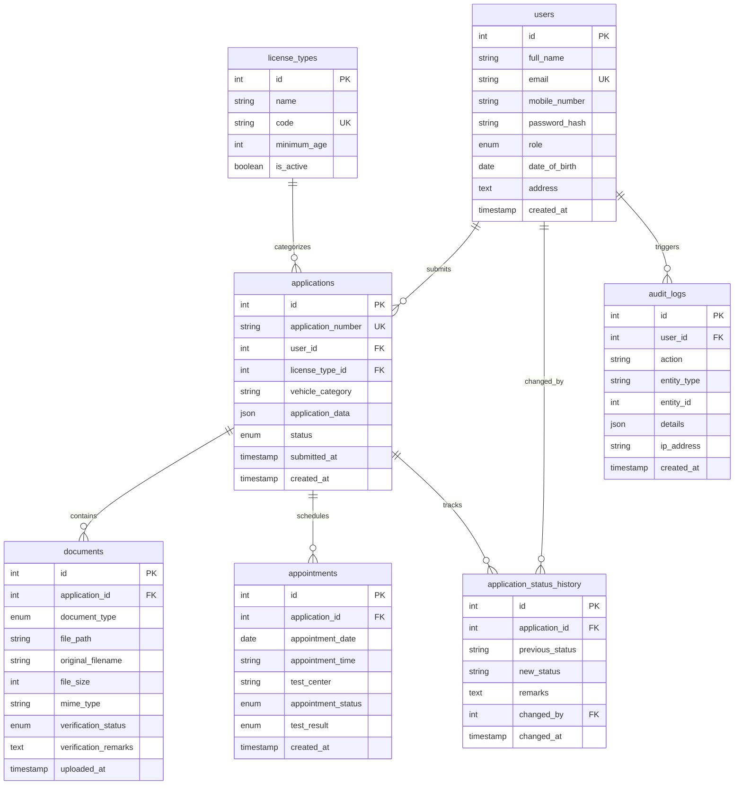

# National Driving License Registration Portal (SARATHI Services)

An enterprise-grade, responsive, full-stack Driving License Registration and Verification Portal built with **React.js**, **Node.js/Express.js**, and a **Relational Database Management System (MySQL)**.

Designed with modern digital government aesthetics, providing citizens with a streamlined, paperless licensing journey and licensing administrators with end-to-end scrutiny, document verification, driving test appointment scheduling, and license issuance.

---

## 1. Technology Stack

- **Frontend:** React.js 18, HTML5, CSS3, JavaScript (ES6+), Tailwind CSS, Lucide React Icons
- **Backend:** Node.js, Express.js
- **Database Engine:** MySQL 8.0+ via `mysql2` *(with built-in automated relational SQL fallback engine for immediate zero-config testing when MySQL daemon is offline)*
- **Authentication:** Stateless JWT (JSON Web Tokens) with secure password hashing via `bcryptjs`
- **File Management:** Multer with MIME-type and size validation (PDF, JPG, PNG up to 5MB)
- **Security:** Helmet HTTP headers, CORS whitelisting, Express Rate Limiting, parameterized SQL queries
- **Testing:** Node.js native test runner (`node --test`), Supertest API suite

---

## 2. User Roles & Workflows

### A. Citizen Applicant
1. **Account Registration & Login:** Create authenticated account with demographic details, age verification, and password.
2. **License Application (Wizard):** Choose license type (Learner's, Permanent DL, Commercial TR, IDP) and vehicle class (MCWOG, MCWG, LMV, etc.).
3. **Document Upload:** Upload mandatory verification documents (Proof of Identity, Address, Photograph, and Signature).
4. **Real-time Status Tracking:** Enter application reference number (e.g., `DL-2026-104921`) to track the scrutiny timeline, officer remarks, and next actions.
5. **Driving Test Booking:** Choose preferred RTO test center, date, and conflict-free time slots.
6. **Receipts & Digital Driving License:** Print official application receipts and view authenticated digital smart driving license cards.

### B. Licensing Administrator
1. **Protected Administration Dashboard:** Real-time KPI metrics, processing queues, and volume breakdown.
2. **Application Scrutiny & Document Verification:** Inspect uploaded citizen proofs in-browser, mark as Verified or Rejected with officer remarks.
3. **Status Transitions:** Enforce statutory state machine transitions:
   - `Submitted` / `Pending Review` ➔ `Approved`, `Correction Required`, or `Rejected`
   - `Approved` ➔ `Test Scheduled`
   - `Test Scheduled` ➔ `Test Passed` or `Test Failed`
   - `Test Passed` ➔ `License Issued` (generates official License Number, e.g., `DL-KA01-2026881928`)
4. **Driving Test Management:** Schedule or reschedule appointments and record practical test results.
5. **Statistical Reports & Audit Logs:** Analyze pipeline distributions, pass/fail ratios, and immutable audit logs.

---

## 3. Database Schema & Relational Design

The database uses a normalized relational schema with primary keys, foreign keys, cascading constraints, and indexes.



---

## 4. REST API Endpoint Reference

| Method | Endpoint | Access | Description |
| :--- | :--- | :--- | :--- |
| **POST** | `/api/auth/register` | Public | Citizen registration with validation |
| **POST** | `/api/auth/login` | Public | Secure login with JWT issuance |
| **POST** | `/api/auth/logout` | Authenticated | Sign out and audit logging |
| **GET** | `/api/auth/me` | Authenticated | Current user session verification |
| **GET** | `/api/applicant/profile` | Applicant | Retrieve citizen profile |
| **PUT** | `/api/applicant/profile` | Applicant | Update address, phone, or password |
| **GET** | `/api/applicant/dashboard` | Applicant | Citizen metrics and recent activity |
| **GET** | `/api/applicant/applications` | Applicant | List citizen's applications |
| **GET** | `/api/applications/license-types` | Public | Available license categories and age rules |
| **POST** | `/api/applications` | Applicant | Create draft or submit application |
| **GET** | `/api/applications/:id` | Owner / Admin | Application dossier with documents |
| **PUT** | `/api/applications/:id` | Owner / Admin | Update application or submit corrections |
| **POST** | `/api/applications/:id/submit` | Owner / Admin | Final application submission |
| **GET** | `/api/applications/track/:appNumber` | Public / User | Live status tracking with audit history |
| **POST** | `/api/applications/:id/documents` | Owner / Admin | Upload verification document (Multer) |
| **GET** | `/api/documents/:id/download` | Owner / Admin | Authorized secure document retrieval |
| **GET** | `/api/appointments/available-slots` | Authenticated | Available test center dates and slots |
| **POST** | `/api/appointments` | Applicant / Admin| Reserve conflict-free test slot |
| **GET** | `/api/admin/dashboard` | Admin Only | Administrative KPI metrics and queues |
| **GET** | `/api/admin/applications` | Admin Only | Search, filter, and paginate applications |
| **PATCH**| `/api/admin/applications/:id/status`| Admin Only | Approve, request correction, or reject |
| **PATCH**| `/api/admin/documents/:id/verification`| Admin Only | Verify or reject uploaded document |
| **PATCH**| `/api/admin/appointments/:id/result`| Admin Only | Record test result (Passed / Failed) |
| **POST** | `/api/admin/applications/:id/issue-license`| Admin Only | Generate and issue official driving license |
| **GET** | `/api/admin/reports` | Admin Only | Statistical analytics and metrics |
| **GET** | `/api/admin/audit-logs` | Admin Only | Security audit logs |

---

## 5. Development Test Accounts (Pre-Seeded)

| Role | Email Address | Password | Permissions |
| :--- | :--- | :--- | :--- |
| **Licensing Admin** | `admin@portal.gov` | `Admin@Secure2026` | Full administrative scrutiny, approval, and licensing controls |
| **Citizen Applicant** | `rahul.sharma@example.com` | `Applicant@123` | Multiple applications (`Pending Review`, `Correction Required`) |
| **Citizen Applicant** | `priya.patel@example.com` | `Applicant@123` | Application `DL-2026-104921` (`Test Scheduled`) |
| **Citizen Applicant** | `ananya.sen@example.com` | `Applicant@123` | Application `DL-2026-102115` (`License Issued`) |

*Demo buttons are conveniently provided on the Login page for one-click authentication.*

---

## 6. Local Setup and Execution Instructions

### Prerequisites
- Node.js (v18.0.0 or higher recommended)
- Optional: MySQL Server 8.0+ running on port 3306

### Step 1: Install Dependencies
```bash
# In the backend directory
cd server
npm install

# In the frontend directory
cd ../client
npm install
```

### Step 2: Database Configuration (MySQL)
1. If using MySQL Server, create a database named `driving_license_db`:
   ```sql
   CREATE DATABASE driving_license_db CHARACTER SET utf8mb4 COLLATE utf8mb4_unicode_ci;
   ```
2. Configure credentials in `server/.env`:
   ```ini
   DB_HOST=localhost
   DB_PORT=3306
   DB_USER=root
   DB_PASSWORD=your_mysql_password
   DB_NAME=driving_license_db
   ```
3. To initialize tables and seed data in MySQL, execute:
   ```bash
   mysql -u root -p driving_license_db < database/schema.sql
   mysql -u root -p driving_license_db < database/seed.sql
   ```
*(Note: If MySQL is not running locally, the server automatically connects to its built-in relational SQL engine with the exact same schema and seeds, ensuring 100% full-stack functionality without blocking development).*

### Step 3: Run the Backend Service
```bash
cd server
npm start
# Server listens at http://localhost:5000
# Health check: http://localhost:5000/api/health
```

### Step 4: Run the React Frontend
```bash
cd client
npm run dev
# Vite dev server runs at http://localhost:5173
```

### Step 5: Execute Automated Test Suite
To execute the comprehensive backend API integration tests:
```bash
cd server
npm test
```
All 17 integration tests across authentication, role authorization, application workflows, document uploads, and database constraints will execute.

---

## 7. Security Features

- **Password Encryption:** Salted bcrypt hashing (10 rounds).
- **Stateless Authorization:** Cryptographically signed JSON Web Tokens (JWT) verified on protected endpoints.
- **Role Isolation:** Strict role-based middleware (`requireRole('admin')`) preventing applicants from accessing administrative routes.
- **SQL Injection Prevention:** 100% parameterized queries via prepared statements.
- **File Upload Safeguards:** Strict MIME-type checking, sanitized file naming, 5MB file-size limits, and authorized private streaming.
- **Brute-Force Protection:** Rate limiting on authentication routes (100 requests per 15 minutes).
- **Security Headers:** Comprehensive Helmet.js integration.
- **Audit Logging:** Administrative status changes, logins, and test results are recorded in `audit_logs`.
